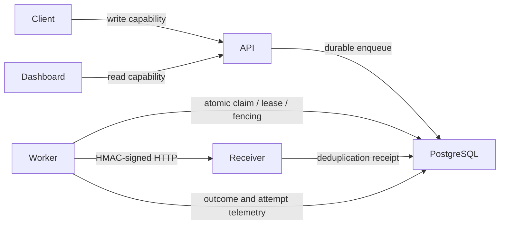

# RelayLab

Durable webhook delivery with TypeScript and PostgreSQL.

RelayLab accepts events, stores them durably, and delivers signed HTTP notifications through competing background workers. It includes scoped API access, retry scheduling, lease recovery, delivery-attempt telemetry, a local dashboard, and automated failure-recovery tests.

**Development system for local execution. Not production-ready.** Delivery is at least once; receiver receipts do not guarantee exactly-once arbitrary business effects.

## Architecture



PostgreSQL provides durable state, uniqueness constraints and transactional coordination. Workers use `FOR UPDATE SKIP LOCKED`, ten-second leases and per-claim fencing tokens. A completion must match the current token and an unexpired lease. Failed completed attempts use exponential backoff with jitter; the fifth failure moves the event to the terminal `dead` state. No redrive endpoint is implemented.

## Run locally

Requires Node.js 24 and Docker Compose for the complete stack. See [PowerShell setup and credential generation](docs/access.md). Set distinct random `API_READ_TOKEN` and `API_WRITE_TOKEN`, plus `RELAY_SECRET` and a URL-safe `POSTGRES_PASSWORD`, then:

```sh
npm ci
docker compose up --build -d --wait
```

Open `http://127.0.0.1:4000` and enter the read token. Only the API port is published, bound to host loopback. Native execution with a local PostgreSQL server is also supported; run `npm start`, `npm run receiver` and `npm run worker` in separate terminals with their documented environment variables.

```sh
curl http://127.0.0.1:4000/events \
  -H "Authorization: Bearer $API_WRITE_TOKEN" \
  -H 'Content-Type: application/json' \
  -H 'Idempotency-Key: order-42' \
  --data '{"type":"order.paid","orderId":42}'
```

A 202 response acknowledges durable acceptance, not completed delivery. Identical requests with the same key reuse the event ID; changed serialized payloads with that key return 409. JSON property order affects current payload equality.

| Endpoint | Access | Purpose |
|---|---|---|
| POST /events | Write capability | Enqueue an object, maximum 64 KiB |
| GET /events | Read capability | Latest 100 event states |
| GET / | Public | Dashboard shell; event reads require a token |
| GET /healthz | Public | Database connectivity check |

Missing/invalid credentials return 401; a valid credential with the wrong scope returns 403. Per-process fixed-window limits return 429 with Retry-After. Capabilities are shared service credentials, not user accounts or tenant isolation.

## Verification

```sh
npm run typecheck
npm test
npm run test:integration
npm run test:e2e
```

The database and HTTP suites start disposable real PostgreSQL servers; component tests also use PGlite. The GitHub Actions workflow runs Windows and Ubuntu checks plus Docker, Chromium, coordinated restart, clean container exit and logical backup/restore comparisons. See [verification scope](docs/verification.md); a workflow file alone is not evidence of a passing run.

Optional diagnostics:

```sh
node --import tsx integration/soak.ts
node --import tsx integration/query-plan.ts
```

The paced soak is not a capacity benchmark. Query-plan candidate indexes are created only in a disposable experiment, not installed by application migrations.

## Engineering documentation

- [Access, secrets and local operation](docs/access.md)
- [Migrations and recovery](docs/migrations.md)
- [Security boundaries](docs/security.md)
- [Engineering review](docs/review.md)
- [Readiness criteria](docs/completion.md)
- [Paced-load methodology](docs/benchmark.md)
- [Query-plan experiment](docs/query-plan.md)

## Known limitations

Runtime services still share an overprivileged database account and perform migrations on startup. Attempts interrupted before completion are not explicitly recorded. Receipts demonstrate durable deduplication, not real payment/shipping execution. Retention, multi-tenant isolation, broader fault tests, measured resource scaling and rotation drills remain open. Keep the service local; no public deployment is approved.
